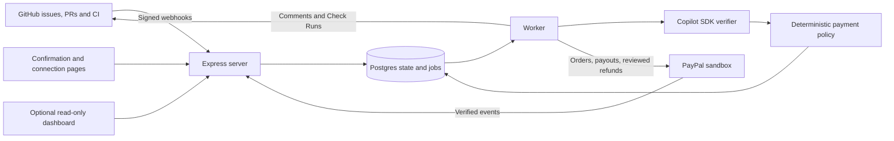

# GitPay

**Fund an issue. Merge a qualifying solution. Pay the contributor.**

GitPay is a planned GitHub App that connects issue bounties to PayPal. Maintainers fund an issue, contributors submit pull requests, AI assesses the proposed solution, and a qualifying merge triggers payment through a deterministic policy.

The principle is **glue, not a platform**: development stays in GitHub, checkout and payouts use PayPal, and small authenticated pages handle confirmations. A dashboard (optional for users, required in the MVP) displays progress without becoming another place to manage the work.

> **Project status (October 30, 2026):** Phases 0, 1 and 4 have recorded completion evidence. Phase 2 has a deferred live revocation check. Phase 3 has a recorded $40 sandbox capture, with receipt/recovery acceptance still open. Phase 5 is advisory and incomplete: Copilot **Auto** is the accepted profile, and the current v2 application-adapter evaluation passed 18/18; the live funded competing-PR/retry walkthrough is still open. The latest [Phases 0–5 review](docs/evidence/00-05-review.md) records fixes and remaining blockers. Phase 6 now has local award selection, immutable payout intents, item reconciliation and claim resumption. Automatic award selection is enabled only for the existing $50 isolated sandbox demo under ADR 0008; remaining Phase 5 checks are deferred and the first sandbox payout is provider-confirmed SUCCESS, with recipient receipt confirmed; delayed-claim/two-author live acceptance remains open. See [Phase 6 evidence](docs/evidence/06-summary.md).

Phases 7 and 8 now have local implementations and automated verification. Their live walkthroughs, along with outstanding Phase 5–6 cases, remain on the [final live checklist](docs/phases/live-walkthroughs.md). See [Phase 8 evidence](docs/evidence/08-summary.md).

## Intended flow

1. A maintainer comments `/bounty create 50` on an issue, or adds `bounty:$50`. This creates an **unfunded draft** when the App is installed and its receiver is running.
2. The repository owner connects a Copilot sponsor account for Copilot Auto. The maintainer signs in, reviews frozen criteria/model/sponsor, confirms the amount and pays through PayPal checkout. Only confirmed capture makes the bounty funded.
3. Anyone with repository access can submit a linked PR, such as `Fixes #12`. There is no exclusive acceptance or reservation.
4. The runtime AI verifier assesses the changes and reports its reasoning in a GitHub Check Run. CI and deterministic policy constrain the result.
5. The first qualifying merged PR under the funded terms earns the bounty. A review case requires an authenticated maintainer decision before payment.
6. Eligible contributors connect their PayPal details. A committed award remains theirs while payment details or transfer problems are resolved.

The `bounty-open` label means submissions remain open, including after funding. Read the bot comment for the funding status.

Typing a command or adding a label on GitHub today does not create a payment. The App must be installed, configured and running; checkout requires authenticated confirmation.

## Fair participation and cancellation

Funded bounties are commitments. A maintainer may **request** cancellation for a serious, evidenced reason; they cannot immediately withdraw the funds.

- Multiple contributors may submit. Opening the first PR or saying “I'll work on it” does not reserve the reward.
- An existing qualifying submission blocks ordinary cancellation while its claim is unresolved. This protection does not automatically make that submission the winner.
- A genuinely independent earlier internal fix, duplicate bounty or invalid issue may justify an exception. Copying a contributor's fix and calling it internal does not.
- The locally implemented exception flow uses public notice, evidence collection and an independent operator’s decision. No AI output authorizes a refund. The 72-hour period is frozen before funding and begins only after confirmed notice publication.
- Accepted awards cannot be cancelled because the contributor has not connected PayPal or a payout failed.
- Without an independent operator, funded refunds remain unavailable. App removal or missing repository access also blocks new refund authorization.

These rules prevent the normal recorded cancel-then-merge abuse path. They cannot force a maintainer to merge, prevent off-platform copying, or guarantee discovery of unseen work. Read [the cancellation decision and its limitations](docs/decisions/0001-open-participation-and-cancellation.md).

## Commands (full MVP target)

Currently available: `/bounty create`, `/bounty status`, `/bounty fund`, and `/bounty cancel` for an unfunded draft. Cancellation opens an authenticated preview; the comment itself cannot cancel the draft. Sandbox funding requires merchant, trusted CI and an explicit Copilot model configuration. Funded cancellation remains disabled in the current deployment and all legacy funded terms. Phase 8 adds a locally verified, independently reviewed exception flow for explicitly scoped new version 5 terms; its real 72-hour refund walkthrough is deferred.

| Command                   | Purpose                                                                                                         |
| ------------------------- | --------------------------------------------------------------------------------------------------------------- |
| `/bounty create <amount>` | Create an unfunded USD bounty draft                                                                             |
| `/bounty fund`            | Get an authenticated funding link                                                                               |
| `/bounty status`          | View progress and request reconciliation                                                                        |
| `/bounty approve`         | Preview and confirm payment for a review case                                                                   |
| `/bounty reject <reason>` | Reject a submission for award consideration; preserve its evidence                                              |
| `/bounty cancel [reason]` | Cancel an unfunded draft, or request a reviewed exception for a funded bounty; funded requests require a reason |
| `/bounty link #<pr>`      | Explicitly link a same-repository PR                                                                            |
| `/bounty retry`           | Retry verification of a PR's current revision                                                                   |

Maintainer commands require current repository write/maintain/admin permission; `/bounty status` is available to participants with access. Financial actions require confirmation or the deterministic settlement policy. Labels never fund or refund money.

## Architecture



| Concern               | Planned choice                                                                           |
| --------------------- | ---------------------------------------------------------------------------------------- |
| Development assistant | Codex, guided by `AGENTS.md`                                                             |
| Runtime               | Node.js 22, TypeScript strict, pnpm workspaces                                           |
| Backend and storage   | Express 5, PostgreSQL 16, Drizzle, durable database jobs                                 |
| GitHub integration    | GitHub App, bounded REST adapter, webhooks, Check Runs and OAuth                                      |
| Payments              | PayPal sandbox Orders, capture, Payouts, refunds and webhooks                            |
| Runtime AI            | Copilot SDK with repository-owner/organization sponsorship; Zod validation                        |
| Web                   | Server-rendered confirmation pages; React/Vite + AG Grid for the optional dashboard      |
| Validation            | Vitest, integration tests, property tests, verifier evaluations and sandbox walkthroughs |
| Deployment target     | Render; deployment configuration is not created yet                                      |

Codex is the coding assistant; Copilot SDK is the selected runtime verifier provider. The model receives no unrestricted authority to move money. See [the provider decision](docs/decisions/0005-copilot-verifier.md).

## Start here

```sh
git clone https://github.com/Me-cha/GitPay.git
cd GitPay
```

Start with [the phased MVP review plan](docs/phases/README.md) and [Phase 00](docs/phases/00.md). Read [IMPLEMENTATION_PLAN.md](IMPLEMENTATION_PLAN.md) for the architecture and [AGENTS.md](AGENTS.md) for repository instructions. Phase 0 provides the executable server workspace. Follow [local setup and provider probes](docs/setup.md); see [Phase 0 evidence](docs/evidence/00-summary.md) for actual checks and remaining gates.

The tracked [.env.example](.env.example) lists validated configuration. Copy it to `.env` and fill in credentials locally. Credentials are intentionally blank; choose an explicit accessible Copilot model before new funding or model generation. Startup and preflight validate their respective required settings. Do not paste secrets into issues, PRs or agent instructions.

External setup will require a GitHub App and demo repository, PayPal sandbox accounts with Payouts access, and a consenting repository-owner or organization Copilot sponsor with model access. Later funded-cancellation testing also needs an independent reviewer identity; unfunded draft cancellation does not. Exact setup requirements are recorded in section 3 of the plan; verify provider documentation during implementation.

## Repository guide

| Path                                                     | Purpose                                                                                                |
| -------------------------------------------------------- | ------------------------------------------------------------------------------------------------------ |
| [IMPLEMENTATION_PLAN.md](IMPLEMENTATION_PLAN.md)         | Canonical architecture, state model, phases and acceptance criteria                                    |
| [PLAN.md](PLAN.md)                                       | Link to the canonical plan                                                                             |
| [AGENTS.md](AGENTS.md)                                   | Codex instructions and current folder map                                                              |
| [Agent.md](Agent.md)                                     | Pointer to `AGENTS.md`                                                                                 |
| [CONTRIBUTING.md](CONTRIBUTING.md)                       | Contribution and verification expectations                                                             |
| [docs/phases/](docs/phases/)                             | Phase status, task contracts and exit gates                                                            |
| [docs/setup.md](docs/setup.md)                           | Local installation, configuration and explicit provider probes                                         |
| [docs/evidence/](docs/evidence/)                         | Recorded local verification and external blockers                                                      |
| [docs/phases/review-todo.md](docs/phases/review-todo.md) | Pre-build remediation checklist for the reviewed plan                                                  |
| [docs/decisions/](docs/decisions/)                       | Product and architecture decisions with reasoning                                                      |
| [packages/server/](packages/server/)                     | Health/webhook server, workers, OAuth sessions, draft confirmations and provider probes |
| [packages/web/](packages/web/)                           | Planned optional dashboard; documentation placeholder                                                  |
| [postman/](postman/)                                     | Planned API/demo collection; documentation placeholder                                                 |

Folder changes must update the current map in `AGENTS.md`, affected README links and the plan's target layout in the same change. The PR template includes this requirement.

## Scope and contributing

The MVP targets USD code bounties and PayPal sandbox. Live money, third-party funding, partial awards, non-code work and other source hosts are outside the initial scope. This is not a production escrow service or a guaranteed dispute-resolution system.

See [CONTRIBUTING.md](CONTRIBUTING.md). Product behavior, credentials and integration success should be documented only when implemented and verified. The implementation plan records the hackathon target; deadlines and eligibility still need official verification.

## License

[MIT](LICENSE), as selected in the implementation plan.

The runtime uses repository-owner-sponsored Copilot Auto in v4 funded terms, preserving legacy terms and recording the concrete serving model for each review ([ADR 0007](docs/decisions/0007-copilot-auto-model.md)). Reviews remain advisory pending accepted live evaluation and settlement implementation. Organization sponsorship and complete sponsor-revocation handling remain open. SDK usage units and attempt caps do not provide a monetary budget.

Phase 7 maintainer review is implemented locally with a shared award guard, exact confirmation and immutable rejection history. Live acceptance remains pending; see [Phase 7 evidence](docs/evidence/07-summary.md).

Remaining live walkthroughs are deferred to the final validation session after local implementation, per user direction. See the [live checklist](docs/phases/live-walkthroughs.md) for outstanding cases and prerequisites.
