# GitPay MVP — phase plan

**Status:** Phase 00 COMPLETE — October 27, 2026; verification and final review are complete. Local checks, GitHub authentication, Nemotron output and PayPal payout/duplicate/recovery/receipt are evidenced. Later phases are not started or authorized. See [Phase 00](00.md) and [provider evidence](../evidence/00-preflight.md).

This is the execution plan for the MVP described in [IMPLEMENTATION_PLAN.md](../../IMPLEMENTATION_PLAN.md). It breaks the existing design into **13 phases and 57 reviewable tasks**, including negative paths and operations. The [cancellation decision](../decisions/0001-open-participation-and-cancellation.md) remains the accepted product policy. The refinements below are the accepted pre-build contract and are reconciled into the master architecture.

## What the MVP delivers

GitPay connects GitHub issues/PRs to PayPal sandbox. Maintainers fund a published issue, anyone may submit a solution, the first qualifying merged PR earns a single award, and eligible contributors receive payouts. Uncertain work receives maintainer review. Exceptional cancellation requires notice, evidence and an independent operator; missing payout details never make an award refundable.

Every main user workflow is in scope, including inability to proceed safely. The product must explain failed/pending payments, lost repository access, unconnected recipients, stale confirmations and unresolved disputes rather than pretending these states do not exist.

The development assistant remains Codex. The runtime verifier uses NVIDIA-hosted Nemotron only, per [ADR 0003](../decisions/0003-nemotron-only-and-preflight-scope.md). Exclusive contributor assignment, dashboard mutations and live-money deployment remain outside scope.

## Review decisions

These are the accepted pre-build decisions for this execution plan. They replace conflicting v4 sketch details where stated; they do not authorize runtime implementation or external provider operations:

| Decision | Accepted MVP choice | Why / consequence |
| --- | --- | --- |
| Basic dashboard | Include scoped Bounties, Payouts, Needs attention and detail views | Users can understand status without a separate management workflow |
| Dashboard extras | Defer Ask bar, charts, pivoting, AG Studio and Enterprise-only features | They do not complete funding, payment or dispute workflows; basic tables can use AG Grid Community |
| CI qualification | When CI is required, require a genuine successful external check; pending/failing/missing CI blocks auto-pay; neutral/skipped-only is insufficient | The old collector counted neutral/skipped as pass. Manual approval may override AI uncertainty but not funded mandatory-CI terms |
| Payment-data storage | Encrypt payout addresses from the beginning, including immutable transfer destination snapshots | Removes the v4 plaintext-sandbox exception and prevents address updates redirecting an already reserved transfer |
| Evidence and financial schemas | Versioned funding attempts and refund intents, immutable evidence snapshots and awards, stable string IDs | The canonical sketch retains abandoned checkout history, append-only submission evidence and aborted unsent refunds while enforcing one active financial reservation |
| Notice period | Use 72 hours, fixed in the terms when funded | Test with an injected clock. A real notice cannot be shortened later just to fit a demo |
| Safe recovery | Reconcile/retry reads and known idempotent operations; show failed delivery requiring operator investigation | A generic “send another payment” action and new replacement payouts remain outside MVP, preserving v4's scope |
| Later provider return | Reopen delivery attention even after a prior PAID receipt, preserving the original award | The unpaid award must become visible again; historical success cannot hide a subsequent verified return/reversal |
| Earliest qualifying merge | Stable GitHub merge-time/PR-ID order with live reconciliation before selection | A late-discovered earlier merge after award becomes an investigation; do not claim GitHub and PayPal can be atomically synchronized or automatically pay twice |

Keep partial awards, changing funded amounts, third-party funding, live money, KYC/tax, verified PayPal identity login, coding-agent bounty discovery, non-code tasks and other source hosts out of this MVP. They remain explicit post-MVP work, not missing core tasks.

## Phase sequence

| Phase | Deliverable | Depends on | Main review checkpoint |
| --- | --- | --- | --- |
| [00 — Foundation and provider feasibility](00.md) | Reproducible workspace, DB, tests, sandbox capability evidence | Plan review | Can we actually use GitHub auth, NVIDIA structured output and PayPal Payouts? |
| [01 — GitHub App, events and drafts](01.md) | Durable webhook/jobs flow and visible unfunded bounties | 00 | Replayed events cannot create duplicate bounties |
| [02 — Authentication and confirmations](02.md) | Login, permission checks and safe draft cancellation | 01 | Money actions cannot be authorized by a label, GET or replayed token |
| [03 — Funding and capture](03.md) | Checkout, immutable funded terms and confirmed capture | 02 | Funded means captured, including after worker failure |
| [04 — Contributor connection](04.md) | Private, identity-bound payout details | 03 | Connecting does not reserve a bounty or redirect an existing intent |
| [05 — Open submissions and verification](05.md) | Multiple PRs, preserved evidence, CI and AI checks | 04 | Verdicts match exact revisions and resist fake fixes/injection |
| [06 — Awards, payouts and claims](06.md) | Deterministic winner/award, payout, delayed claim resumption | 05 | One award, exact amounts, no duplicate transfer |
| [07 — Maintainer review](07.md) | Full-amount approval and reasoned rejection/reconsideration | 06 | Review uses the same guards as automatic settlement |
| [08 — Exceptional cancellation](08.md) | Notice, objections, independent review and guarded refunds | 07 | Cancel-then-merge fails; genuine exceptions still work |
| [09 — Visibility and user journeys](09.md) | Read-only dashboard, scoped live updates and usable pages | 08 | Every state explains the responsible actor and next action |
| [10 — Recovery and hardening](10.md) | Reconciliation, fault tests, operations and coverage audit | 09 | Restarts/missed events do not lose claims or duplicate money |
| [11 — Hosted sandbox validation](11.md) | Deployment, migrations/restore, hosted workflows | 10 | Actual hosted flows and recovery are evidenced |
| [12 — Acceptance and demo](12.md) | Complete acceptance record, accurate setup and demo | 11 | Claims match verified behavior; user reviews the finished MVP |

```mermaid
flowchart LR
    P00[00 Foundation] --> P01[01 GitHub drafts]
    P01 --> P02[02 Auth]
    P02 --> P03[03 Funding]
    P03 --> P04[04 Connection]
    P04 --> P05[05 Verification]
    P05 --> P06[06 Awards and payouts]
    P06 --> P07[07 Review]
    P07 --> P08[08 Cancellation]
    P08 --> P09[09 Visibility]
    P09 --> P10[10 Recovery]
    P10 --> P11[11 Deployment]
    P11 --> P12[12 Acceptance]
```

Default execution is sequential. After shared contracts are stable, fixtures, read-only UI and documentation can be developed independently, but shared migrations, action guards, award selection and refund/payout code need coordinated ownership. Do not split financial logic across simultaneous uncoordinated edits.

### Build priority versus acceptance order

The phase dependency order remains authoritative, but implementation should be risk-first:

1. Prove the demo-critical transaction path first: Phase 00 feasibility, GitHub draft/authentication (01–02), funding (03), contributor connection (04), bounded verification (05) and one-award payout (06).
2. Add the smallest read-only status surface needed to inspect that path. Dashboard polish, charts and natural-language analysis remain outside MVP.
3. Harden maintainer review (07), exceptional cancellation/refunds (08) and recovery (10) before enabling those capabilities. A cancellation request can be demonstrated as blocked before a real 72-hour refund workflow is available.
4. Hosted validation (11) and final acceptance (12) remain mandatory for calling the complete MVP done. The demo-critical path is an execution priority, not a reduced acceptance standard.

This makes schedule risk visible without silently dropping financial safety gates or claiming a partial demo is the complete product.

These files replace the old monolithic phase checklist as the execution breakdown. Old phase 7 is split into 07/08; old dashboard phase 8 becomes 09; new recovery phase is 10; old deployment/demo phases become 11/12. Stretch work is no longer a numbered MVP phase.

## Workflow coverage and release acceptance

| ID | Required workflow | Implemented by | Required evidence |
| --- | --- | --- | --- |
| W01 | Install App, identify current access, create draft via comment or label | 00–02 | Actual GitHub draft plus unauthorized/replay tests |
| W02 | Fund through checkout, return/cancel checkout, confirm actual capture | 03 | Sandbox capture ID and duplicate/unknown-outcome tests |
| W03 | Cancel an unfunded draft safely | 02–03 | No PayPal call; capture-race refusal |
| W04 | Multiple contributors submit linked PRs, including before funding | 05 | Two PRs remain eligible; no exclusive acceptance |
| W05 | Verify exact revision, show CI/evidence, retry errors and new commits | 05 | Model evaluation plus stale-SHA/error tests |
| W06 | Select qualifying merged solution and pay exact eligible allocation | 06 | Sandbox recipient receipt and concurrent/replay tests |
| W07 | Split a winning submission's award among eligible co-contributors | 05–06 | Exact-cent property tests and two-author sandbox evidence |
| W08 | Contributor connects after earning award; payment resumes | 04/06 | AWAITING_CLAIM → connection → payout; no refund option |
| W09 | Maintainer approves review case or rejects/reconsiders | 07 | Full-amount preview, actor/reason log and next-candidate test |
| W10 | Request cancellation for genuine independent fix or invalid bounty | 08 | Notice, separate reviewer and real sandbox refund |
| W11 | Protect valid submission from cancel-then-merge, copy or erased evidence | 05/08 | Abuse test matrix; no refund when claim remains unresolved |
| W12 | Contributor raises objection; operator dismisses spam or keeps dispute held | 08 | Non-writer evidence collected; reasoned decision; no silent auto-refund |
| W13 | Recover pending/failed/unknown/returned payments and refunds safely | 03/06/08/10 | Real transaction fault tests and operator next-action runbook |
| W14 | Handle webhook gaps, duplicate deliveries, app removal and permission loss | 01/02/10 | Restart/reconciliation tests and hosted recovery |
| W15 | View scoped status, history, receipts and attention across UI surfaces | 09 | Browser and access-boundary tests including SSE |
| W16 | Reproduce, deploy and demonstrate the sandbox MVP | 00/11/12 | Fresh-clone setup, hosted evidence and final acceptance record |

Real-money reversals, disputes outside the recorded protocol and forced acceptance of a PR are not promised. Blocking an unfair refund does not itself force a maintainer to select a contributor.

## Execution contract

1. **Scope first.** Phase 00 is authorized. The plan does not authorize later phases or external account operations; follow the current user request.
2. **Existing references.** Read AGENTS.md, the relevant architecture section and the phase before implementing. User instructions take precedence. If approved, these phase contracts refine the v4 schema sketches; reconcile the master architecture with approved refinements before implementing Phase 00.
3. **Task size.** Each numbered task owns a reviewable contract and approximately 3–5 primary files. Split framework boilerplate into a small prerequisite task if required; do not balloon a task into multiple unrelated subsystems.
4. **Tests and evidence.** For behavior changes use meaningful failing cases, implement, then verify. Config/docs need direct validation, not tests that mirror the config. External probes and browser walkthroughs require observations; mocks do not prove provider integration.
5. **Checks.** Phase 00 provides `pnpm typecheck`, `pnpm lint`, `pnpm test`, `pnpm build` and `pnpm exec vitest run <path>`. Server integration tests use isolated Postgres through an explicitly exported TEST_DATABASE_URL and deny unmatched provider calls. See [setup](../setup.md).
6. **Future scripts.** `pnpm eval:verifier` is added in 05. The web package and its test/build scripts are added in 09; React tests use a DOM test environment. `pnpm test:e2e` is a separate Playwright suite from 09, excluded from Vitest. Each task adds its relevant package/config dependencies explicitly.
7. **Shared invariants.** Sandbox only, integer cents, one award, exact recipient allocation, preserved evidence, no network inside DB transactions, no exclusive claims, and independent refund review. Snapshot mutable provider results outside locks and verify versions before committing.
8. **Durable operations.** Store intent, identity and request key before financial calls. Differentiate provably unsent from may-have-submitted. Unknown outcomes remain reserved until reconciliation. Never reset an operation just to make a test/demo work.
9. **Boundaries.** Webhook routes verify/dedupe/store durable work, then acknowledge; workers perform slow processing. Actor authorization is produced by trusted server code, not deserialized from a client request. External data and AI output are untrusted.
10. **Migrations.** Add schema with its owning phase. The master SQL is a domain sketch, not an instruction to create all tables in 00. Track migration versions, constrain statuses and use separate connections for concurrency tests.
11. **Configuration.** Each introduced timeout, retry/rate bound, reconciliation interval or size limit must have explicit validated config and documented test value. Freeze monetary/eligibility policy and notice duration with funded terms; later config changes cannot silently change a funded contract.
12. **Completion.** Record commands/results and manual/provider evidence under `docs/evidence/NN-summary.md`. Mark local-complete/external-blocked separately; all external gates must pass for phase/MVP completion. No placeholder evidence files are counted as results.
13. **Maintenance.** Update current folder map, module ownership, setup, env examples and phase status in the same change. Keep exact commands in manifests once implemented. Commit/push/deploy only within the authorized task.

## Shared interface vocabulary

Phase 00 creates `packages/server/src/domain/types.ts`; later phases extend this vocabulary without silently renaming it. Internal timestamps use `Date`; JSON DTOs use ISO strings. Stable IDs are strings at API/DB boundaries, avoiding unsafe bigint-to-Number conversion.

| Contract | Required shape / authority | Owner |
| --- | --- | --- |
| `Cents`, `GitHubId` | Validated nonnegative integer cents (positive for a transfer); string identity | 00 |
| `BountyRef`, `PrRef` | `{repoId:string,issueNumber:number}` / `{repoId:string,prNumber:number}` | 00 |
| `ActorContext` | `{actorGhId:string,source:ActionSource,authorization:Authorization}`; server-created, current action/repo/role scope | 00/02 |
| `ActionResult<T>` | `{ok:true,value:T}` or `{ok:false,code:string,message:string,retryable:boolean}`; safe messages | 00 |
| `Clock` | `now(): Date`; real clock in runtime, controllable clock for notice/retry tests | 00 |
| `JobSpec`, `LeasedJob` | Validated kind/payload/dedupeKey/runAfter; claimed job adds leaseOwner/leaseToken/lockedUntil and heartbeat ownership | 01 |
| `Bounty` | id, ref, amountCents, status, version, fundedTerms, evidenceVersion, current candidate and attention | 01/03/06 |
| `FundingIntent`, `OrderSnapshot` | Historical attempt ID, bounty, actor, terms hash, exact amount/currency, request keys, order/capture IDs and normalized outcome | 03 |
| `Contributor` | Stable GitHub ID, display login, encrypted destination plus key version and connection time; safe DTO omits ciphertext/raw email | 04 |
| `AuthorIdentity` | Stable GitHub ID, canonical login and server evidence source; commit trailers alone are not payment identity | 05/06 |
| `SubmissionEvidenceSnapshot` | Immutable bounty/PR/SHA snapshot with evidence version, observed time, bounded evidence and access confidence | 05 |
| `Submission` | Stable PR/repo IDs, number, head SHA, current assessment and references to immutable evidence snapshots | 05 |
| `CiSnapshot`, `VerifyInput` | Exact SHA, external check identity/status/time; funded criteria, bounded patches, verified author identities and truncation flags | 05 |
| `VerifierResult`, `VerificationRecord` | Validated verdict or error; persisted SHA/attempt/model/prompt/input limits/CI/evidence references | 05 |
| `Allocation`, `AuthorWeight` | `{ghId:string,login:string,cents:Cents}[]` / `{ghId:string,weight:number}`; no arbitrary email or unverified identity | 06 |
| `Award` | Immutable unique pay decision: bounty, winning PR/revision, allocation, actor/policy and reason | 06/07 |
| `CancellationRequest`, `EvidenceBundle` | Requester, reason, notice, versioned evidence, reviewer/decision, unresolved claims and access confidence | 08 |
| `RefundIntent` | Request/evidence version, original capture, exact cents, prior state, persisted request identity, submission boundary and outcome; historical intents remain queryable with one active reservation | 08 |

Provider adapter snapshots must be explicitly Zod-validated and mapped; they are not raw SDK responses passed throughout the app. The owning task defines the full discriminated union before downstream consumption. Use direct module contracts; no new microservices or generalized workflow framework is needed.

## Schema ownership and sketch corrections

| Phase | Migration responsibilities |
| --- | --- |
| 00 | Migration runner; durable deliveries/jobs with lease ownership and typed payloads |
| 01 | Installations, bounty drafts, activity and active-issue uniqueness |
| 02 | OAuth state, sessions, action tokens and action/version bindings |
| 03 | Funding attempts, original funder, immutable terms and capture references |
| 04 | Encrypted contributor destinations with version/key metadata |
| 05 | Links, submission evidence, assessments and versioned verifications |
| 06 | Unique immutable award, transfer intents/items and stable provider identities |
| 08 | Cancellation requests, review history, multiple historical refund intents with one active intent, unsent-abort/submission boundary |

The canonical schema retains historical funding attempts and refund intents, append-only evidence snapshots, encrypted contributor destinations and encrypted payout destination snapshots. A partial unique index enforces one active refund reservation per request while allowing an aborted unsent intent followed by a fresh reviewed intent. Preserve confirmed awards when a provider returns money. Compute paid principal + unpaid committed award + reserved/confirmed refunds without counting in-flight transfers twice.

GitHub event acknowledgement requires delivery receipt and job creation in the same transaction. Marking an event “seen” before its job is durable loses work on a crash. Worker lease ownership and heartbeats prevent an expired worker from overwriting a newer worker's result; financial intent guards remain the last boundary against duplicate submission.

## Review focus

| Failure mode | Required behavior | Owning task |
| --- | --- | --- |
| Delayed merge delivery or incomplete pagination selects the wrong winner | Reconcile/order all known candidates, hold earlier undecided merge; late post-award conflict becomes investigation, no second award | 05.01, 06.02, 10.01 |
| Cancellation approval outlives new work or app access | New evidence invalidates approval; missing visibility blocks refund; unsent and ambiguous intents have distinct recovery | 08.02–08.05, 10.03 |
| User corrects email while payout is already reserved | Existing intent keeps its original destination; updates affect only future unsubmitted intent creation | 04.02, 06.03 |
| Webhook acknowledged before durable job or expired worker resumes | Transactional inbox/jobs; current lease ownership; intent identity survives crash/replay | 01.01–01.02, 10.03 |
| Fake/skipped checks or injected author identity cause auto-pay | Required successful external CI; verified author identities; bounded untrusted model output | 05.02–05.05, 06.01, 07.02 |

## External setup and blockers

- **GitHub:** owner-controlled App/demo repository and separate maintainer/contributor identities. Add an independent reviewer with evidence access for cancellation. Account creation, secret values and collaborator invitations require the owner's action/authorization.
- **PayPal:** sandbox business platform account, maintainer and contributor personal sandbox accounts, Payouts capability and sufficient sandbox balance. A second contributor account is needed to evidence a two-author award. Feasibility is not assumed from credentials existing.
- **NVIDIA:** a permitted API key and access to the selected Nemotron model. Probe its capability and evaluate it before automatic verification. Record the exact profile and failures; model listing alone does not prove inference capability.
- **Hosting:** account, region/plan and durable Postgres/worker capability must be verified in 11. Never invent a working deployment URL or free-worker guarantee.
- **Independent review:** someone must actually operate the exception process. Without that person, funded refunds remain disabled and full W10 acceptance is blocked. Development can establish local correctness, but it cannot invent operating capacity.
- **Notice:** the planned 72-hour real notice may determine earliest live-refund test timing. Schedule a legitimate test request early once Phase 08 is ready; use test clocks only for labelled automated/simulated cases.

## Sources checked while planning

These checks inform the design; they do not prove an integration is configured:

- GitHub requires prompt webhook acknowledgement and recommends asynchronous processing. [Webhook best practices](https://docs.github.com/en/webhooks/using-webhooks/best-practices-for-using-webhooks).
- Failed GitHub deliveries are not automatically redelivered. Implement scheduled recovery and state reconciliation. [Failed deliveries](https://docs.github.com/en/webhooks/using-webhooks/handling-failed-webhook-deliveries).
- PayPal request-ID support and retention depend on the API. Keep local operation identity and verify the endpoint-specific contract rather than assuming indefinite deduplication. [Idempotency](https://developer.paypal.com/api/rest/reference/idempotency/).
- Payout batches/items have distinct create/read operations. Verify their detailed schemas and actual sandbox behavior in 00/06. [Payouts API](https://developer.paypal.com/api/payments.payouts-batch/v1).

## Review checklist

- [ ] The W01–W16 workflow coverage matches the intended MVP.
- [x] The refinements above are reconciled into the master plan, including CI review rules, dashboard scope and encrypted payout details.
- [ ] Open participation and first qualifying merge remain the intended selection policy.
- [ ] Independent reviewer responsibility and the proposed notice duration are acceptable.
- [x] We agree on the first implementation slice: Phase 00, with external capability evidence clearly separated from local checks. Authorized October 26, 2026.

The review remediation is tracked in [review-todo.md](review-todo.md). Phase 00 is complete with scoped provider evidence. Phase 01 is ready for its own scope authorization; it has not started. These documents do not authorize all phases.
