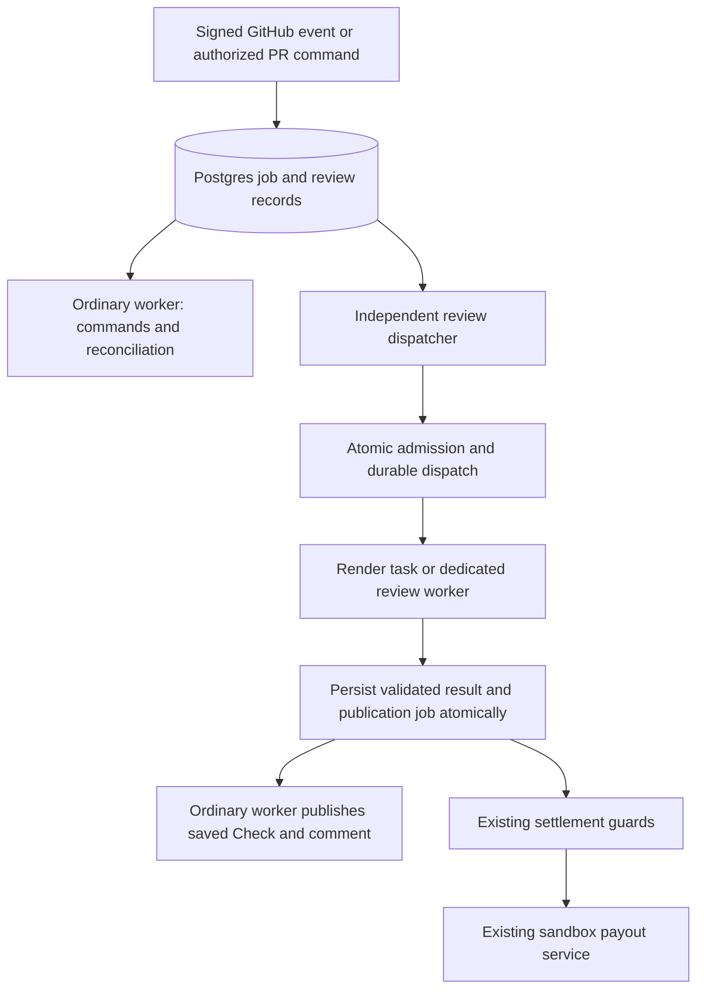

# Repopay: independent AI review execution with Render Workflows

Partner discussion and prototype plan · November 9, 2026

**Status: proposed, not implemented or benchmarked.** This revision incorporates the source review and the dispatch, recovery, permissions and measurement requirements. Approval of this document does not provision resources, activate a backend or authorize Copilot usage. Adoption remains conditional on the comparison below.

## 1. Purpose and scope

Repopay connects GitHub issues, sponsored Copilot reviews and PayPal sandbox payouts. We want slow AI reviews to stop delaying ordinary GitHub commands and the worker's next funding/payout reconciliation cycle.

The current [worker loop](../packages/server/src/jobs/runner.ts) awaits one job at a time. A review includes evidence collection, sponsor authorization, a Copilot request with a 120-second runtime deadline, and GitHub publication. Its complete duration can be longer. During that wait, the same loop cannot process the next command or reconciliation cycle. Asynchronous waits do not freeze HTTP handling, and another worker could continue processing. This is a source-confirmed scheduling constraint; its impact on production traffic has not been measured.

Prototype one Render task, `verifySubmission`, receiving only a dispatch ID. Reuse the evidence collector, Copilot Auto adapter and output validation behind a refactored execution boundary. Compare it with a dedicated review worker before choosing a backend.

The existing [foundation scope](decisions/0021-foundation-mvp-scope.md) remains applicable: GitHub is the work surface; Postgres is authoritative; deterministic settlement controls automatic payout after a qualifying merge. Authentication, captured funds, current evidence and CI, sponsor checks, recipient eligibility, allocation, exact bounty scope and payment idempotency remain mandatory. This proposal does not change winner selection or contributor splitting, and it does not activate additional financial exercises.

## 2. Architecture and ownership

Keep the original durable job for traceability. Add a separate dispatch record for the execution lifecycle; do not stretch a short job lease across a remote task's lifetime.

| Component | Responsibility |
| --- | --- |
| Ordinary worker | Commands, projections and existing financial reconciliation; never claims model-execution jobs in the isolated mode. |
| Review dispatcher | Claims only review-dispatch work, reserves admission, triggers or reconciles a remote launch. It runs independently of the ordinary loop. |
| Execution backend | Claims the authorized dispatch, collects bounded evidence, invokes Copilot at most once for that attempt, validates and persists its outcome. |
| Publication worker | Uses the persisted attempt/result to create or update GitHub Checks and comments; never invokes Copilot. |
| Existing settlement | Recollects current evidence and applies all award/payment guards. Render completion alone never authorizes payment. |

The existing queue claims jobs without a kind filter. Add explicit claim filters and backend ownership before enabling isolation. Merely starting another copy of the current worker does not implement a dedicated review worker.

The dispatcher calls Render's start API and stores the run ID; it never waits for the task result. Bound launch requests with a timeout. A stalled Render API call must not occupy the loop that reconciles payments. Uncertain launches are durable work for later reconciliation, not untracked in-memory promises.

## 3. Durable dispatch and inference identity

Proposed dispatch fields:

- Original job ID, review request ID, verification attempt ID and immutable dispatch ID.
- Bounty, repository, submission, sponsor GitHub ID and expected head/base revisions.
- Evidence ID/hash when collected; prompt version/hash, Copilot SDK version and pinned execution artifact version.
- Backend, backend-generation number, Render run ID, launch idempotency key and launch timestamps.
- Ownership token/generation, heartbeat, admission reservation, inference-start boundary and completion timestamps.
- Safe state/error classification; no plaintext tokens, source text or payout destinations.

One review request maps to one dispatch and one inference attempt. Retrying delivery of that request reuses these identities. A deliberate fresh review creates a new authorized request and attempt; deduplication must not suppress legitimate later reviews forever.

Use separate execution and publication states:

| Execution state | Meaning and permitted recovery |
| --- | --- |
| READY | Durable request exists; no capacity or model request consumed. |
| ADMITTED | Capacity reserved transactionally; launch has not crossed its external boundary. |
| LAUNCHING / LAUNCH_UNKNOWN | Launch may have reached Render. Reconcile with the same dispatch/key; never invent a replacement inference identity. |
| RUNNING_PRE_INFERENCE | One owner has claimed the dispatch. Known pre-inference failure may be retried after ownership is safely resolved. |
| INFERENCE_STARTED | Persisted immediately before the adapter invocation. A retry cannot cross this boundary again for the same attempt. |
| RESULT_SAVED | Validated outcome stored with its original evidence and provenance; publication can retry independently. |
| OUTCOME_UNKNOWN | Inference may have happened, but no durable usable outcome exists. Block automatic re-inference and surface a safe explanation. |
| FAILED_BEFORE_INFERENCE / SUPERSEDED | Terminal failure before inference, or obsolete authorization/revision/generation. Preserve history and resolve admission safely. |

Publication separately records PENDING, PUBLISHED or RETRY_REQUIRED. A publication failure must not convert a saved successful review into an inference failure.

The dispatch job completes when a launch acknowledgement/run identity is durably recorded or a durable uncertain-launch recovery record takes ownership. If the dispatcher crashes before this transaction, reclaiming its job reconciles the existing dispatch. The task may start before the launcher saves the run ID: task-side claim must bind its run identity atomically and reject competing owners.

### Retry and uncertain-outcome rules

1. Configure Render `maxRetries: 0` for the first prototype. Its documented default is three retries; relying on defaults would multiply executions.
2. Database job retries, manual Render replay and dedicated-worker retries must all pass the same dispatch/inference guard. Disabling Render retries alone is insufficient.
3. Retry a lost launch response only with the original workflow, version, arguments and idempotency key within its documented retention window. After that window, require reconciled run/ownership evidence; never assume the first run did not happen.
4. A repeated run for a completed dispatch returns a small status without invoking the model. An active or uncertain dispatch cannot acquire a second inference owner.
5. Once INFERENCE_STARTED is committed, a crash before or after the actual network send may be indistinguishable. Record the uncertainty conservatively; do not claim provider-level exactly-once execution or silently refund the request allowance.
6. If no result can be recovered, a new model attempt needs a deliberate authorized retry and remaining allowance. Preserve and link the uncertain attempt.

Render deduplicates launch keys for 24 hours, scoped to a workflow. That does not supply permanent application idempotency or exactly-once external effects. Aborting the client request does not cancel an already-created Render run. See [trigger semantics](https://render.com/docs/workflows-running).

## 4. Persist before publishing

The current [verifier service](../packages/server/src/verifier/service.ts) updates the GitHub Check before saving the completed verdict. Correct this independently of the backend choice.

After output validation and final authorization/version checks, one database transaction must:

1. Verify the current dispatch owner, execution generation and review eligibility.
2. Save the result, model provenance, usage, evidence identity and attempt outcome.
3. Insert a deduplicated publication job referencing that exact attempt.

No GitHub request occurs inside that transaction. Persist a validated late result as superseded history when appropriate; it must not become current settlement evidence.

The publisher uses a stable external Check identity and reconciles a lost create response before creating another Check. It updates the Check belonging to that attempt. Serialize current PR-summary publication by submission and recheck the current attempt so a delayed old publication cannot overwrite a newer summary. Historical Checks remain available.

An in-progress Check is optional projection work, not a prerequisite to inference. Publication retries after a saved result make zero model requests. Keep publication failures visible without discarding successful reviews.

## 5. Admission, budgets and stale-task fencing

Start with **two globally admitted reviews, one per sponsor GitHub ID and one per submission**. Sponsor identity applies across repositories; a repository-only lock does not enforce a sponsor-wide limit.

Reserve all three capacity constraints atomically in Postgres. Count launching, queued-at-provider, running and unresolved runs that may still execute. Reserve the applicable request allowance under the same durable concurrency discipline before inference; distinguish capacity, request allowance and observed provider usage. These limits do not constitute a hard monetary budget.

Admission must skip temporarily ineligible work so one sponsor's backlog cannot starve another sponsor. Tasks waiting for capacity stay in Postgres and do not spin up paid instances merely to wait.

Heartbeats indicate liveness, not proof that execution stopped. On expiry, fence the old owner from accepting results and investigate the run. Release a physical execution slot only after termination/terminal state or another documented proof of non-execution. A task that lost ownership must not enter inference. Unknown calls retain conservative usage accounting even after compute is confirmed terminated.

Recheck current revision, evidence, installation/access, sponsor authorization and backend generation before inference and before accepting its result. Bind accepted results to prompt/SDK/artifact versions. Sponsor refresh remains fenced against revocation and concurrent refresh; never use ambient operator credentials.

Set explicit task and adapter deadlines. A provisional task timeout is 300 seconds, including evidence collection, the existing 120-second Copilot runtime deadline, cleanup and persistence; validate this against measurements before adoption. On cancellation or timeout, stop the Copilot subprocess and preserve any uncertain inference state.

## 6. Credentials and restricted database access

Do not load the broad existing `FundingEnv` into review tasks. Add a review-specific configuration contract and deployment secret set.

Tasks need authorized GitHub evidence access and the separately consented Copilot sponsor grant. They must receive **no PayPal credentials, payout-data decryption key, broad financial database role or migration privileges**. The Render launch API key belongs to the dispatcher, not to the review task.

The existing verifier also writes submission evidence, review attempts, jobs and bounty attention; sponsor refresh updates encrypted tokens. It cannot be wrapped unchanged with a read-only role. Refactor these writes into explicit permitted operations:

| Access | Proposed boundary |
| --- | --- |
| Read review inputs | Scoped views/queries for authorized dispatches, frozen criteria, revisions, CI and contributor attestations. Exclude payout destinations. |
| Persist evidence/result | Narrow operations that enforce dispatch ownership, revision and immutable evidence identity. |
| Refresh sponsor grant | A narrow, revision-fenced refresh operation or internal sponsor service; no unrestricted token-table administration. |
| Enqueue publication | Typed operation allowing only review projection work, not arbitrary jobs/payloads. |
| Update bounty attention or current financial-facing state | Existing trusted worker processes a typed saved-review outcome. |
| Awards, transfers, capture/refund records and frozen terms | No task write permission. |

Dispatch IDs are identifiers, not authorization credentials. Validate task identity, backend generation and dispatch ownership. SQL grants alone cannot isolate rows when the role is otherwise broad: implement scoped operations/row policies as needed and test the actual deployed role. Do not use the database owner account for tasks.

The current pool permits five connections per process. Two task processes could add up to ten connections, plus web/ordinary workers and the dispatcher. Measure connection use, configure task-specific limits and preserve operational headroom. Never let the concurrency test starve payment reconciliation of database connections.

Render retains task arguments and return values for 30 days. Use `{dispatchId}` and small status/record-ID results only. Keep tokens, source evidence, model text and payout information out of workflow arguments, return values, exceptions and logs. Preserve the Copilot adapter's restricted subprocess environment and temporary-directory cleanup. See [retention and limits](https://render.com/docs/workflows-limits).

## 7. Compatibility, maintenance and rollback

Pin the invoked Render task version; do not dispatch to an unqualified latest definition. Persist the artifact, prompt, SDK and evidence-contract versions for each dispatch. Render supports versioned task identifiers in its [task API](https://api-docs.render.com/reference/createtask).

Use a durable review-execution generation shared by dispatcher and tasks. A backend switch pauses admission, inventories active/unknown runs, drains or cancels and reconciles them, then advances the generation before new work is admitted. Old tasks cannot accept results under the new generation. Review maintenance must not stop reconciliation of existing financial intents; full database restore continues to follow the existing recovery-hold procedure.

Use additive migrations first and verify schema compatibility in each process. Do not remove columns or privileges while an old supported task version can still run. Rollback must reconcile every dispatch before enabling the dedicated-worker adapter; never let both adapters infer for the same request.

## 8. Alternatives and adoption criteria

| Option | Strength | Tradeoff |
| --- | --- | --- |
| Shared worker | Current simple deployment | A slow review delays work in the same loop. |
| Dedicated review worker | Warm execution and fewer external coordination steps | We operate and size standing review capacity. |
| Render Workflows | Per-run instances, on-demand capacity and managed run visibility | Cold starts, usage charges and additional dispatch/recovery coordination. |

Workflows may suit intermittent or bursty demand. It does not make Copilot more accurate or inherently accelerate a single model response. The ordinary application and worker still run. Compare both isolated options using the same durable-attempt and publication fixes; otherwise the comparison would mix reliability changes with backend effects.

### Proposed benchmark contract

These are initial decision thresholds, not measured results or an approved spend allowance. Agree changes before collecting the adoption dataset.

| Measurement | Initial acceptance criterion |
| --- | --- |
| Command responsiveness | With a 30-second mocked review, command completion p95 increases by no more than 2 seconds over the same backend's no-review baseline, with identical polling/provider delays. |
| Reconciliation scheduling | Under the same test, additional due-check lateness is at most one configured worker poll interval plus 2 seconds. Measure scheduling separately from provider response time. |
| Concurrency | Two different sponsors' model calls overlap; a third admitted review, a second same-sponsor review or a second same-submission review never exceeds its cap. |
| Review latency | Hosted mocked 30-second reviews have dispatch-to-result p95 no more than 15 seconds above the dedicated-worker comparison, including cold starts and queue wait. Report each component separately. |
| Database headroom | No pool-acquisition timeout or connection-limit error; measured peak connections remain below an explicitly reserved database budget for web/operational work. |
| Safety | Zero unauthorized additional model invocations, accepted stale results, task financial writes or duplicate financial operations in the named fault tests. |
| Cost | Compare measured compute, retention and bandwidth plus existing app/DB costs for an agreed traffic profile. Record Copilot usage separately. Adopt only within a separately approved monthly ceiling; no ceiling is assumed here. |

Run at least 50 controlled command/review observations per backend, including no-review and burst workloads, and at least 20 independent hosted task starts with a mocked model. Report sample counts, p50/p95/max, failures and cold-start observations. This is pilot evidence, not a production SLA. These sample sizes do not authorize real Copilot requests; separately bound live smoke requests and paid Render compute.

## 9. Required tests and early runtime smoke

Before building the full Render adapter, prove a minimal hosted task can boot the pinned Node/Copilot runtime, launch and stop its subprocess, create/clean temporary directories, connect to Postgres with the intended restricted credentials, access GitHub and refresh a test sponsor grant. Use mocked inference first; a separately approved real request establishes provider compatibility. Confirm region/network connectivity and resource access instead of assuming the existing web-service configuration transfers unchanged.

The failure suite must cover:

- Duplicate webhooks, duplicate dispatch jobs, manual task replay and two concurrent claimers.
- Lost launch acknowledgement, including recovery after the 24-hour deduplication window.
- Task start before run-ID persistence; dispatcher crash before/after acknowledging its job.
- Crash immediately before/after the inference-start boundary, response loss, and result-save failure after a response.
- Successful result save followed by failed Check creation/update, failed comment publication and lost publication responses; no repeated inference.
- Heartbeat loss with the old task still alive, timeout cleanup, capacity recovery and sponsor fairness.
- Changed head/base, stale CI/evidence, revoked sponsor/access and backend-generation changes during execution.
- Real restricted-role attempts to mutate financial records or enqueue an arbitrary job; all denied.
- Existing award, payout, capture and idempotency regressions continuing to pass.

Fault tests use controlled providers and real database/process behavior. Hosted tests establish actual task startup, networking, runtime compatibility and execution visibility. Neither replaces the other.

## 10. Delivery sequence

1. **Record baseline and freeze the benchmark contract.** Capture the shared-worker behavior, resource budget and proposed traffic profile. Record the source commit used; the root checkout and the last deployed rebrand release are different histories.
2. **Run the small runtime feasibility spike.** Confirm Render task packaging, subprocess support, credentials and connectivity before investing in full integration. Provisioning and provider usage require their applicable authorization.
3. **Implement backend-independent reliability.** Add dispatch/attempt identity, inference-start accounting, ownership fencing and atomic result/publication persistence. Test against mocked providers.
4. **Implement routing and the dedicated-worker baseline.** Ordinary workers exclude review execution; the isolated adapter uses the common admission and recovery contracts.
5. **Implement one Render task and its dispatcher.** Add explicit retries/timeouts, version pinning, run reconciliation, restricted roles and task-specific configuration. Keep activation default-off.
6. **Verify failure handling and compare execution.** Run local/integration checks, then approved hosted measurements and a bounded real-provider smoke test.
7. **Make the adoption decision.** Record the results and cost ceiling in an ADR. If Workflows does not justify its complexity, adopt the dedicated worker with the same reliability fixes.
8. **Release and observe.** Use the authorized release process, a limited repository rollout and the documented pause/drain/reconcile rollback. Do not repeat completed payout demonstrations merely to benchmark scheduling.

Implementation should update affected queue/verifier contracts, tests, configuration examples, deployment docs and repository ownership notes in the same release. New migration/module names are to be chosen against the actual implementation branch; they are not existing entrypoints.

## 11. Partner demonstration and recommendation

Demonstrate two independent reviews progressing while a GitHub status command is answered and due reconciliation continues. Trace a dispatch through Postgres, its Render run and the published GitHub Check. Connect that execution story to the already-evidenced qualifying-merge-to-sandbox-payout journey.

Proceed with the bounded prototype and comparison. Prefer the backend that meets the agreed responsiveness, reliability, latency and cost criteria. Render's role should be justified by measured product behavior. Prize eligibility is not asserted here: the original pasted proposal did not include the actual sponsor-track or official-rule URLs, so those claims must be verified before use in partner/submission material.

### References

- [Render Workflows overview](https://render.com/docs/workflows)
- [Task definitions, retries and timeouts](https://render.com/docs/workflows-defining-tasks)
- [Triggering runs, deduplication and client cancellation](https://render.com/docs/workflows-running)
- [Task API and versioned identifiers](https://api-docs.render.com/reference/createtask)
- [Limits, retention and pricing](https://render.com/docs/workflows-limits)
- [Current job leases/retries](../packages/server/src/jobs/queue.ts), [worker execution](../packages/server/src/jobs/runner.ts), [verifier orchestration](../packages/server/src/verifier/service.ts), [Copilot runtime](../packages/server/src/models/copilot.ts), [sponsor refresh](../packages/server/src/github/oauth.ts)
- [Foundation scope](decisions/0021-foundation-mvp-scope.md), [recovery contracts](phases/10.md), [deployment contracts](phases/11.md), [hosted foundation evidence](evidence/11-hosted.md)

Provider semantics were checked against the official documentation on November 9, 2026. Recheck the selected SDK/API versions, limits and account-specific pricing before implementation or provisioning.
